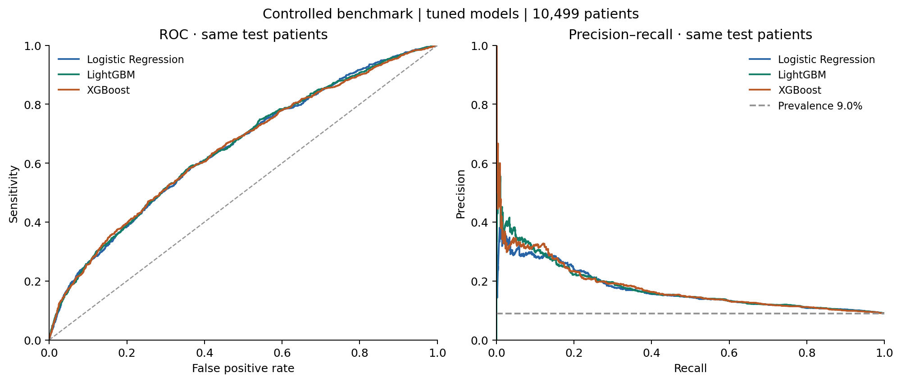

# Diabetes Readmission: Reproducible Machine Learning

Predicting hospital readmission within 30 days for patients with diabetes, using the **UCI Diabetes 130-US Hospitals (1999–2008)** dataset. This academic project explores class imbalance, interpretable prediction, threshold selection, and patient segmentation.

**Start here:** [Controlled comparison](docs/model_comparison.md) · [Results notebook](notebooks/04_analysis_findings.ipynb) · [Original report](reports/bare_jrnl.pdf) · [Original presentation](presentation/slides.pdf) · [Data documentation](docs/data_sources.md)

## Project Topic

Early hospital readmission is a difficult, imbalanced classification problem. We investigate patterns in recorded encounters and how precision and recall change with the decision threshold. The positive class is `readmitted == "<30"`; `NO` and `>30` form the negative class.

The original CP8305 team project includes exploratory analysis, feature engineering, supervised comparisons, and unsupervised analysis. This portfolio edition adds a reproducible baseline and a controlled three-model benchmark, with training-only preprocessing, bounded cross-validation searches, validation-selected thresholds and paired uncertainty estimates.

## Controlled Benchmark Results

The portfolio extension compares **Logistic Regression, LightGBM and XGBoost** on the same 69,990 eligible unique patients and 22 predictors. Training/validation/test partitions are 70%/15%/15%, with zero patient overlap. All fitted preprocessing and hyperparameter searches use training data; each threshold is chosen on validation F1. Prediction is defined **at discharge**, assuming final encounter fields are available.

Measured on 10,499 test patients (943 positives), with 1,000 paired patient-bootstrap resamples:

| Model | ROC-AUC (95% CI) | Average precision (95% CI) | F1 (95% CI) |
| --- | --- | --- | --- |
| Logistic Regression | 0.6500 [0.6316, 0.6680] | 0.1706 [0.1517, 0.1913] | 0.2250 [0.2045, 0.2437] |
| LightGBM | 0.6513 [0.6328, 0.6690] | 0.1766 [0.1574, 0.1994] | 0.2280 [0.2085, 0.2482] |
| XGBoost | 0.6500 [0.6307, 0.6669] | 0.1765 [0.1567, 0.1981] | 0.2311 [0.2127, 0.2505] |

Intervals are pointwise 95% bootstrap intervals. All pairwise ROC-AUC, AP and F1 difference intervals among these tuned models include zero: **the experiment does not establish a clear winner**. Selected thresholds are 0.11 for all three; precision is about 16% and recall about 39–40%. This is a modest retrospective research benchmark, not a clinical decision system.



The test patients were already used in the earlier portfolio baseline, so this is not pristine confirmatory or external validation. The new protocol was frozen before new test evaluation. [Full comparison](docs/model_comparison.md) includes all nine initial/tuned/calibrated variants, exact counts, paired differences, calibration, negative results, interpretation and error analysis.

| Evidence layer | Status |
| --- | --- |
| Original academic project | Historical LightGBM mean ROC-AUC 0.654 and F1 0.226 are archived CV summaries under a different protocol; not directly comparable to the new test table. |
| Initial portfolio baseline | Logistic ROC-AUC 0.630149, AP 0.155981, F1 0.221704; reproduced exactly. [Original record](reports/portfolio/baseline/metrics.json). |
| Controlled benchmark | Full-cohort three-model development and frozen evaluation executed on 2026-10-12. Tuned logistic ROC-AUC/AP increased from its reference; its F1 improvement is uncertain. Calibration did not improve Brier point estimates. |

See [methodology](docs/methodology.md), [technical audit](docs/technical_audit.md), [model card](docs/model_card.md), [verification](docs/benchmark_validation.md), and [resume/interview notes](docs/career_notes.md).

## Quick Start

Use **Python 3.12**, the version tested for this edition. Download this repository using **Code → Download ZIP**, extract it, and open a terminal in the extracted folder. Git users can clone the URL shown by **Code → HTTPS** instead.

Create an isolated environment:

```bash
python -m venv .venv
```

Activate it on macOS/Linux:

```bash
source .venv/bin/activate
```

Or in Windows PowerShell:

```powershell
.venv\Scripts\Activate.ps1
```

Install dependencies, download the public data, and run the experiment:

```bash
python -m pip install -r requirements-benchmark.txt
python -m src.download_data
python -m src.benchmark --stage develop
python -m src.benchmark --stage evaluate
```

The download uses the official UCI archive without a Kaggle account. The benchmark writes aggregate results under `reports/runs/benchmark/aggregate/` and keeps fitted models, predictions and identifier-derived checks under ignored `reports/runs/benchmark/private/`. It refuses to overwrite completed runs; choose new `--output` and `--private` directories for another experiment. Development requires an absent or empty private directory and rejects reuse before writing any output, including after an interrupted run. The measured full development run took about 4.3 minutes, plus evaluation, on this environment; other hardware may differ. Linux/Python 3.12 is validated.

For a smaller mechanics check, add `--smoke` to the development command and use separate output directories. Its 600-patient results are not portfolio scores. To reproduce the original logistic baseline alone, install `requirements-core.txt` and run `python -m src.baseline`.

### Review the results notebook

Notebook 04 reads committed aggregate CSV/JSON results; no patient CSV or saved model is required.

```bash
python -m pip install -r requirements-summary.txt
python scripts/run_notebook.py notebooks/04_analysis_findings.ipynb
```

The executed copy is written under `reports/runs/`. If kernel sockets are unavailable, add `--in-process` to execute trusted cells sequentially with IPython. This was the execution method used in the preparation environment.

### Explore the original research notebooks

```bash
python -m pip install -r requirements.txt
jupyter notebook
```

| Notebook | Purpose and inputs |
| --- | --- |
| [01_data_exploration.ipynb](notebooks/01_data_exploration.ipynb) | Distributions, missingness, associations, and diagnosis groups from the raw CSV. |
| [02_data_preprocessing.ipynb](notebooks/02_data_preprocessing.ipynb) | Cohort filtering, diagnosis grouping, engineered features, and processed CSV export. |
| [03_modeling.ipynb](notebooks/03_modeling.ipynb) | Supervised comparisons, tuning, interpretation, and illustrative cost analysis; requires notebook 02 output. |
| [04_analysis_findings.ipynb](notebooks/04_analysis_findings.ipynb) | Executable review of committed historical results and the new baseline. |
| [05_unsupervised_modelling.ipynb](notebooks/05_unsupervised_modelling.ipynb) | PCA, clustering, cluster profiles, and association rules; requires notebook 02 output. |

The original extended dependencies are not fully locked. Notebooks 01, 03, and 05 have not been rerun end to end in this edition; see [verification scope](docs/validation.md). The standalone `src.data_preprocessing` module offers generic helpers, not the complete diabetes-specific workflow in notebook 02.

To keep fresh research outputs separate from archived reports, set `CP8305_REPORTS_DIR` before running a notebook. On macOS/Linux:

```bash
CP8305_REPORTS_DIR="$PWD/reports/runs/research" python scripts/run_notebook.py notebooks/03_modeling.ipynb
```

In PowerShell, set `$env:CP8305_REPORTS_DIR = "$PWD/reports/runs/research"` first. The Slurm `.sh` files are optional cluster templates, not required for local use.

## Repository Structure

| Path | Contents |
| --- | --- |
| `data/diabetes130/raw/` | Tracked `IDS_mapping.csv`; downloaded `diabetic_data.csv` and download manifest stay local. |
| `data/diabetes130/processed/` | Notebook 02 output, `processed_dataset.csv`, generated locally. |
| `notebooks/` | Five notebooks, a Python launcher, and Slurm templates. |
| `src/` | Data loading, preprocessing, feature engineering, modeling, visualization, shared paths, the baseline, and the controlled benchmark/evaluation pipeline. |
| `reports/` | Original PDF/LaTeX report, bibliography, saved model, 38 historical figures, and 8 historical CSV tables. |
| `reports/portfolio/` | Initial baseline metrics, summary figures, and source hashes. |
| `reports/benchmark/` | Controlled experiment configuration, aggregate metrics/intervals, search traces and six diagnostic figures. |
| `presentation/` | Original PDF slides, Beamer source, bibliography, build script, figures, and reference resources. |
| `notes/` | Original preprocessing and modeling checklists. |
| `scripts/refactor/` | Six development scripts for the original modeling refactor. |
| `scripts/run_notebook.py` | Executes notebooks using the active Python environment. |
| `docs/` | Provenance, audits, benchmark methodology/results, model card, validation and career notes. |
| `tests/` | Checks for cohort rules, patient separation, train-only preprocessing, model integration, calibration, bootstrap, freeze integrity, paths, and downloading. |
| `.github/workflows/` | Automated unit checks and results-notebook execution. |

## Dependencies and Checks

- `requirements-benchmark.txt`: pinned direct CPU benchmark stack, including LightGBM and XGBoost.
- `requirements-core.txt`: pinned direct dependencies for the baseline and preprocessing.
- `requirements-summary.txt`: pinned notebook execution dependencies plus the core stack.
- `requirements.txt`: extended research libraries, including boosting and explainability tools; not a complete environment lock.

```bash
python -m unittest discover -s tests -v
python -m compileall -q src scripts
```

CI checks patient separation, preprocessing, all three estimators, nested calibration, paired metrics, persistence and a synthetic two-process benchmark round trip, then executes notebook 04. It does not rerun the full real-data experiment or download patient records. See the linked verification record for actual run status.

## Deliverables

- [x] Original final report: [PDF](reports/bare_jrnl.pdf), [LaTeX](reports/bare_jrnl.tex), and [bibliography](reports/references.bib).
- [x] Final presentation: [PDF](presentation/slides.pdf) and [Beamer source](presentation/slides.tex). No PowerPoint file is included.
- [x] Five notebooks, reusable Python modules, historical figures/tables, and development notes/scripts.
- [x] Completed [data documentation](docs/data_sources.md) and official-source downloader.
- [x] Reproducible patient-disjoint baseline, recorded metrics, tests, and results review.
- [x] Controlled three-model benchmark, bounded tuning, calibration diagnostics, paired uncertainty, sensitivity/error analysis and documented limitations.

## Team and Provenance

Original academic team: **Christopher Indris, Mojtaba Mohammadi, and Mohammad Al Batayneh**.

All three team members collaborated throughout the project, including research, implementation, experimentation, and analysis. The project was a shared academic effort rather than three independently assigned components.

This edition builds on [chrisindris/CP8305FP](https://github.com/chrisindris/CP8305FP), `main` at [d340d61aa0aa7f7828409dfeae4f27c437c50d4a](https://github.com/chrisindris/CP8305FP/commit/d340d61aa0aa7f7828409dfeae4f27c437c50d4a), dated 2026-09-26. Original authorship and Git history are retained. The original PDF report, presentation, model, and aggregate results remain historical artifacts; the new experiment is labeled separately.

Portfolio maintenance, developed with AI coding assistance, adds executable documentation, portable paths, an independent baseline, a controlled three-model benchmark, threshold-selection fixes, checks, and cleanup of generated build files. See the [original README audit](docs/repository_audit.md) and [validation record](docs/validation.md). This repository represents a team project; it does not attribute all original work to one contributor.

The UCI dataset is distributed under CC BY 4.0. The upstream snapshot has no repository-wide `LICENSE`; this edition does not assert a new license over the team's work or third-party resources.

## References

1. Clore, J., Cios, K., DeShazo, J., & Strack, B. (2014). *Diabetes 130-US Hospitals for Years 1999–2008* [Dataset]. UCI Machine Learning Repository. https://doi.org/10.24432/C5230J
2. Strack, B., et al. (2014). Impact of HbA1c measurement on hospital readmission rates: Analysis of 70,000 clinical database patient records. *BioMed Research International*. https://doi.org/10.1155/2014/781670
3. Graham, E., Saxena, A., & Kirby, H. (2019). Identifying high risk patients for hospital readmission. *SMU Data Science Review, 2*(1), Article 22. https://scholar.smu.edu/datasciencereview/vol2/iss1/22
4. Shang, Y., et al. (2021). The 30-days hospital readmission risk in diabetic patients: Predictive modeling with machine learning classifiers. *BMC Medical Informatics and Decision Making*. https://doi.org/10.1186/s12911-021-01423-y
5. Liu, V. B., Sue, L. Y., & Wu, Y. (2024). Comparison of machine learning models for predicting 30-day readmission rates for patients with diabetes. *Journal of Medical Artificial Intelligence*. https://doi.org/10.21037/jmai-24-70

Additional references are preserved in the report and presentation bibliographies.
