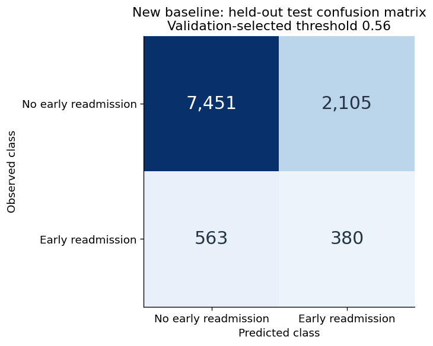

# Diabetes Readmission: Reproducible Machine Learning

Predicting hospital readmission within 30 days for patients with diabetes, using the **UCI Diabetes 130-US Hospitals (1999–2008)** dataset. This academic project explores class imbalance, interpretable prediction, threshold selection, and patient segmentation.

**Start here:** [Results notebook](notebooks/04_analysis_findings.ipynb) · [Original report](reports/bare_jrnl.pdf) · [Original presentation](presentation/slides.pdf) · [Data documentation](docs/data_sources.md)

## Project Topic

Early hospital readmission is a difficult, imbalanced classification problem. We investigate patterns in recorded encounters and how precision and recall change with the decision threshold. The positive class is `readmitted == "<30"`; `NO` and `>30` form the negative class.

The original CP8305 team project includes exploratory analysis, feature engineering, supervised comparisons, and unsupervised analysis. This portfolio edition adds a compact experiment that can be rerun from the original CSV, with preprocessing learned on training data and a separate validation set for threshold selection.

## Results You Can Reproduce

The new baseline uses class-weighted logistic regression with 22 predictors. After excluding specified expired/hospice discharge codes and keeping one eligible encounter per patient, **69,990 patients** remain. A stratified 70% / 15% / 15% split has **zero patient overlap** between training, validation, and test sets.

| Held-out test measure | Result |
| --- | ---: |
| Test patients | 10,499 |
| Positive class prevalence | 8.98% |
| ROC-AUC | 0.630 |
| Average precision | 0.156 |
| F1 | 0.222 |
| Precision | 0.153 |
| Recall | 0.403 |
| Decision threshold, chosen on validation F1 | 0.56 |

Source: [recorded run and environment](reports/portfolio/baseline/metrics.json), executed on 2026-10-11. Values are rounded; the JSON includes full precision, cohort counts, source and implementation hashes, and both default- and selected-threshold metrics.



At this threshold, 380 of 943 positive cases are detected, with 2,105 false positives. This is a modest research baseline with substantial missed cases and false alerts. It has no external or temporal validation and is not a clinical decision system. See [evaluation limits](docs/validation.md).

**Historical results:** the original stored comparison reports LightGBM mean ROC-AUC **0.654** and mean F1 **0.226**. Those cross-validation artifacts use a different protocol and were not retrained for this edition. They are reviewed separately in [notebook 04](notebooks/04_analysis_findings.ipynb); they do not establish that the new baseline improves performance.

## Quick Start

Use **Python 3.12**, the version tested for this edition. Download this repository using **Code → Download ZIP**, extract it, and open a terminal in the extracted folder. Git users can clone the URL shown by **Code → HTTPS** instead.

Create an isolated environment:

```bash
python -m venv .venv
```

Activate it on macOS/Linux:

```bash
source .venv/bin/activate
```

Or in Windows PowerShell:

```powershell
.venv\Scripts\Activate.ps1
```

Install dependencies, download the public data, and run the experiment:

```bash
python -m pip install -r requirements-core.txt
python -m src.download_data
python -m src.baseline
```

The download requires internet access. It retrieves the official UCI archive without a Kaggle account and records file hashes locally. The baseline writes `reports/runs/baseline/metrics.json`; raw data and exploratory run outputs are ignored by Git.

For a small execution check, use `python -m src.baseline --max-rows 5000`. Subset results are not the full-cohort results reported above.

### Review the results notebook

Notebook 04 reads committed aggregate CSV/JSON results; no patient CSV or saved model is required.

```bash
python -m pip install -r requirements-summary.txt
python scripts/run_notebook.py notebooks/04_analysis_findings.ipynb
```

The executed copy is written under `reports/runs/`. If kernel sockets are unavailable, add `--in-process` to execute trusted cells sequentially with IPython. This was the execution method used in the preparation environment.

### Explore the original research notebooks

```bash
python -m pip install -r requirements.txt
jupyter notebook
```

| Notebook | Purpose and inputs |
| --- | --- |
| [01_data_exploration.ipynb](notebooks/01_data_exploration.ipynb) | Distributions, missingness, associations, and diagnosis groups from the raw CSV. |
| [02_data_preprocessing.ipynb](notebooks/02_data_preprocessing.ipynb) | Cohort filtering, diagnosis grouping, engineered features, and processed CSV export. |
| [03_modeling.ipynb](notebooks/03_modeling.ipynb) | Supervised comparisons, tuning, interpretation, and illustrative cost analysis; requires notebook 02 output. |
| [04_analysis_findings.ipynb](notebooks/04_analysis_findings.ipynb) | Executable review of committed historical results and the new baseline. |
| [05_unsupervised_modelling.ipynb](notebooks/05_unsupervised_modelling.ipynb) | PCA, clustering, cluster profiles, and association rules; requires notebook 02 output. |

The original extended dependencies are not fully locked. Notebooks 01, 03, and 05 have not been rerun end to end in this edition; see [verification scope](docs/validation.md). The standalone `src.data_preprocessing` module offers generic helpers, not the complete diabetes-specific workflow in notebook 02.

To keep fresh research outputs separate from archived reports, set `CP8305_REPORTS_DIR` before running a notebook. On macOS/Linux:

```bash
CP8305_REPORTS_DIR="$PWD/reports/runs/research" python scripts/run_notebook.py notebooks/03_modeling.ipynb
```

In PowerShell, set `$env:CP8305_REPORTS_DIR = "$PWD/reports/runs/research"` first. The Slurm `.sh` files are optional cluster templates, not required for local use.

## Repository Structure

| Path | Contents |
| --- | --- |
| `data/diabetes130/raw/` | Tracked `IDS_mapping.csv`; downloaded `diabetic_data.csv` and download manifest stay local. |
| `data/diabetes130/processed/` | Notebook 02 output, `processed_dataset.csv`, generated locally. |
| `notebooks/` | Five notebooks, a Python launcher, and Slurm templates. |
| `src/` | Data loading, preprocessing, feature engineering, modeling, visualization, shared paths, and the new baseline. |
| `reports/` | Original PDF/LaTeX report, bibliography, saved model, 38 historical figures, and 8 historical CSV tables. |
| `reports/portfolio/` | New baseline metrics, summary figures, and source hashes. |
| `presentation/` | Original PDF slides, Beamer source, bibliography, build script, figures, and reference resources. |
| `notes/` | Original preprocessing and modeling checklists. |
| `scripts/refactor/` | Six development scripts for the original modeling refactor. |
| `scripts/run_notebook.py` | Executes notebooks using the active Python environment. |
| `docs/` | Dataset provenance, validation limits, and original README audit. |
| `tests/` | Checks for cohort rules, patient separation, train-only preprocessing, paths, and downloading. |
| `.github/workflows/` | Automated unit checks and results-notebook execution. |

## Dependencies and Checks

- `requirements-core.txt`: pinned direct dependencies for the baseline and preprocessing.
- `requirements-summary.txt`: pinned notebook execution dependencies plus the core stack.
- `requirements.txt`: extended research libraries, including boosting and explainability tools; not a complete environment lock.

```bash
python -m unittest discover -s tests -v
python -m compileall -q src scripts
```

CI performs these checks and executes notebook 04 from committed results. It does not rerun every original model or download patient records.

## Deliverables

- [x] Original final report: [PDF](reports/bare_jrnl.pdf), [LaTeX](reports/bare_jrnl.tex), and [bibliography](reports/references.bib).
- [x] Final presentation: [PDF](presentation/slides.pdf) and [Beamer source](presentation/slides.tex). No PowerPoint file is included.
- [x] Five notebooks, reusable Python modules, historical figures/tables, and development notes/scripts.
- [x] Completed [data documentation](docs/data_sources.md) and official-source downloader.
- [x] Reproducible patient-disjoint baseline, recorded metrics, tests, and results review.

## Team and Provenance

Original academic team: **Christopher Indris, Mojtaba Mohammadi, and Mohammad Al Batayneh**.

All three team members collaborated throughout the project, including research, implementation, experimentation, and analysis. The project was a shared academic effort rather than three independently assigned components.

This edition builds on [chrisindris/CP8305FP](https://github.com/chrisindris/CP8305FP), `main` at [d340d61aa0aa7f7828409dfeae4f27c437c50d4a](https://github.com/chrisindris/CP8305FP/commit/d340d61aa0aa7f7828409dfeae4f27c437c50d4a), dated 2026-09-26. Original authorship and Git history are retained. The original PDF report, presentation, model, and aggregate results remain historical artifacts; the new experiment is labeled separately.

Portfolio maintenance adds executable documentation, portable paths, an independent baseline, threshold-selection fixes, checks, and cleanup of generated build files. See the [original README audit](docs/repository_audit.md) and [validation record](docs/validation.md). This repository represents a team project; it does not attribute all original work to one contributor.

The UCI dataset is distributed under CC BY 4.0. The upstream snapshot has no repository-wide `LICENSE`; this edition does not assert a new license over the team's work or third-party resources.

## References

1. Clore, J., Cios, K., DeShazo, J., & Strack, B. (2014). *Diabetes 130-US Hospitals for Years 1999–2008* [Dataset]. UCI Machine Learning Repository. https://doi.org/10.24432/C5230J
2. Strack, B., et al. (2014). Impact of HbA1c measurement on hospital readmission rates: Analysis of 70,000 clinical database patient records. *BioMed Research International*. https://doi.org/10.1155/2014/781670
3. Graham, E., Saxena, A., & Kirby, H. (2019). Identifying high risk patients for hospital readmission. *SMU Data Science Review, 2*(1), Article 22. https://scholar.smu.edu/datasciencereview/vol2/iss1/22
4. Shang, Y., et al. (2021). The 30-days hospital readmission risk in diabetic patients: Predictive modeling with machine learning classifiers. *BMC Medical Informatics and Decision Making*. https://doi.org/10.1186/s12911-021-01423-y
5. Liu, V. B., Sue, L. Y., & Wu, Y. (2024). Comparison of machine learning models for predicting 30-day readmission rates for patients with diabetes. *Journal of Medical Artificial Intelligence*. https://doi.org/10.21037/jmai-24-70

Additional references are preserved in the report and presentation bibliographies.
