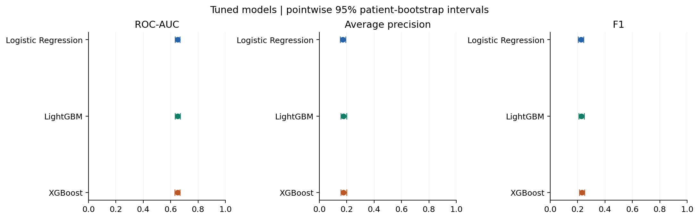
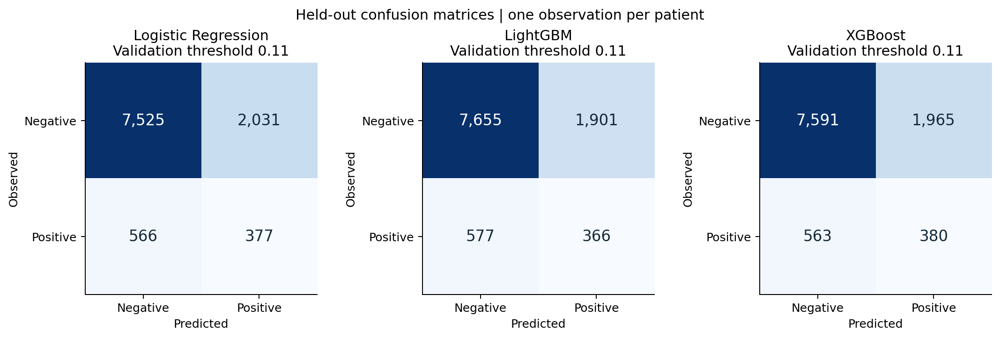
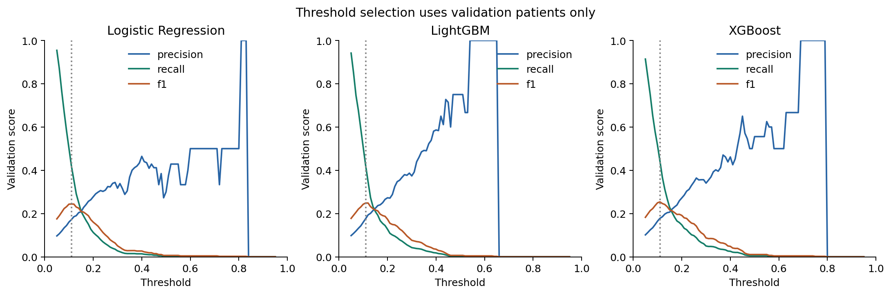
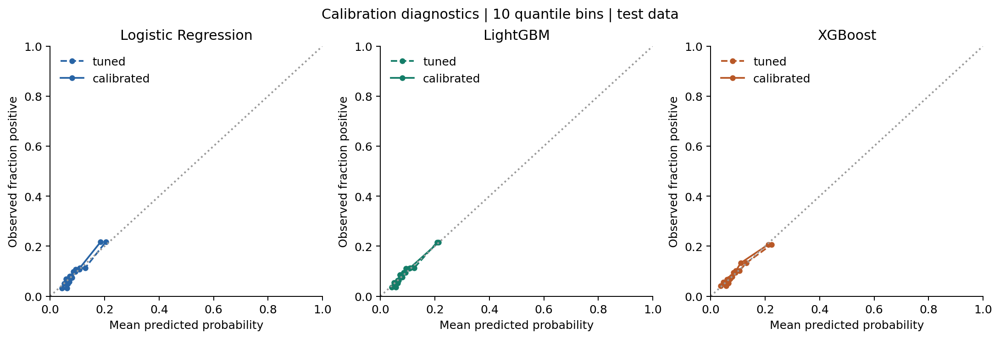
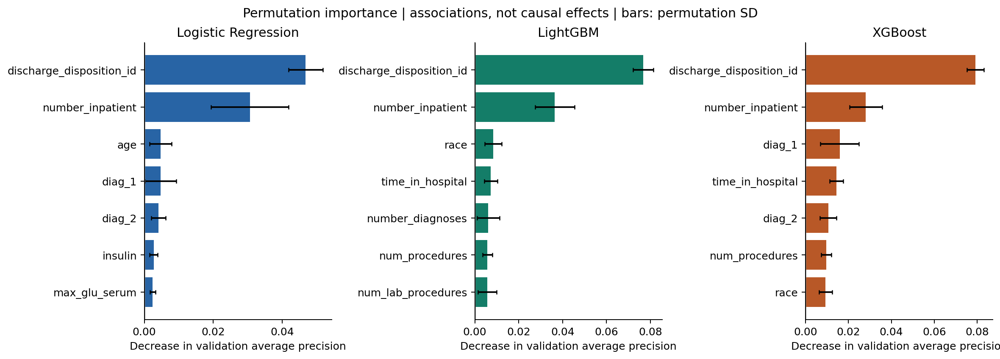

# Controlled model comparison — measured results

Executed on **2026-10-12**, with the complete official UCI cohort. All three algorithms used the same 22 predictors and the same patient-disjoint 48,993 / 10,498 / 10,499 training/validation/test split. There are **943 positives among 10,499 test patients (8.982%)**. Hyperparameters were selected using training CV; thresholds were selected on validation F1 and frozen before this extension's test evaluation.

The test set was previously inspected for the initial portfolio baseline. These are controlled internal comparisons, not pristine confirmatory, temporal, or external validation. [Full methodology](methodology.md) · [audit](technical_audit.md) · [execution record](benchmark_validation.md).

## Primary comparison: tuned models

Point estimates with pointwise 95% percentile intervals from 1,000 patient bootstrap resamples:

| Model | ROC-AUC (95% CI) | Average precision (95% CI) | F1 (95% CI) |
| --- | --- | --- | --- |
| Logistic Regression | 0.6500 [0.6316, 0.6680] | 0.1706 [0.1517, 0.1913] | 0.2250 [0.2045, 0.2437] |
| LightGBM | 0.6513 [0.6328, 0.6690] | 0.1766 [0.1574, 0.1994] | 0.2280 [0.2085, 0.2482] |
| XGBoost | 0.6500 [0.6307, 0.6669] | 0.1765 [0.1567, 0.1981] | 0.2311 [0.2127, 0.2505] |

The same bootstrap draws were used for all models. Every primary pairwise ROC-AUC, AP and F1 difference interval includes zero. This experiment does **not establish a clear advantage among the tuned algorithms**. That is not proof of equivalence. LightGBM has the highest AP point estimate by only 0.000151 over XGBoost; the paired AP difference interval is [-0.005646, 0.006662]. No multiplicity-adjusted significance claim is made.

### Operating points and error counts

| model | threshold | precision | recall | specificity | balanced_accuracy | brier_score | log_loss |
| --- | --- | --- | --- | --- | --- | --- | --- |
| logistic_tuned | 0.1100 | 0.1566 | 0.3998 | 0.7875 | 0.5936 | 0.0792 | 0.2891 |
| lightgbm_tuned | 0.1100 | 0.1614 | 0.3881 | 0.8011 | 0.5946 | 0.0790 | 0.2883 |
| xgboost_tuned | 0.1100 | 0.1620 | 0.4030 | 0.7944 | 0.5987 | 0.0790 | 0.2887 |

| model | tn | fp | fn | tp |
| --- | --- | --- | --- | --- |
| logistic_tuned | 7525 | 2031 | 566 | 377 |
| lightgbm_tuned | 7655 | 1901 | 577 | 366 |
| xgboost_tuned | 7591 | 1965 | 563 | 380 |

All three happened to select threshold 0.11 independently on validation F1. At that setting, about 39–40% of positive cases are detected and precision is about 16%. Most predicted positives are false alerts. These operating points are not validated clinical decisions.

## Initial models, tuning and calibration

All prespecified variants, including unsuccessful changes, are retained:

| model | roc_auc | average_precision | f1 | brier_score | log_loss | threshold |
| --- | --- | --- | --- | --- | --- | --- |
| logistic_initial | 0.6301 | 0.1560 | 0.2217 | 0.2185 | 0.6293 | 0.5600 |
| logistic_tuned | 0.6500 | 0.1706 | 0.2250 | 0.0792 | 0.2891 | 0.1100 |
| logistic_calibrated | 0.6500 | 0.1706 | 0.2281 | 0.0796 | 0.2908 | 0.1000 |
| lightgbm_initial | 0.6450 | 0.1734 | 0.2284 | 0.2225 | 0.6371 | 0.5500 |
| lightgbm_tuned | 0.6513 | 0.1766 | 0.2280 | 0.0790 | 0.2883 | 0.1100 |
| lightgbm_calibrated | 0.6513 | 0.1766 | 0.2279 | 0.0792 | 0.2894 | 0.1000 |
| xgboost_initial | 0.6409 | 0.1745 | 0.2282 | 0.2283 | 0.6496 | 0.5500 |
| xgboost_tuned | 0.6500 | 0.1765 | 0.2311 | 0.0790 | 0.2887 | 0.1100 |
| xgboost_calibrated | 0.6500 | 0.1765 | 0.2315 | 0.0794 | 0.2899 | 0.0900 |

The initial Logistic Regression exactly reproduces every recorded reference metric and the selected threshold. Relative to that model, tuned Logistic Regression increased ROC-AUC by 0.019811 (paired interval [0.008290, 0.031719]) and AP by 0.014604 ([0.003994, 0.023894]); its F1 change of 0.003304 has an interval crossing zero. The selected configuration changes both regularization and weighting; the gain cannot be attributed to one factor alone.

The boosting models' tuned AP and F1 differences from their own initial versions also have intervals crossing zero. Large Brier reductions from initial weighted models accompany the selected unweighted settings, rather than proving a universal benefit from more tuning.

Sigmoid calibration **did not improve Brier point estimates** for any tuned model in this run; Logistic Regression and XGBoost's paired Brier differences are above zero within their pointwise intervals. ROC-AUC and AP remain unchanged because the fitted sigmoid preserves ranking. Thresholded precision/recall may still change. The primary uncalibrated tuned comparison was designated before test evaluation, not chosen in response to these results.

A constant prediction equal to training prevalence (0.089809) yields test Brier **0.081751** and log loss **0.302117**. The tuned models improve on this probability reference only modestly. Brier combines calibration and discrimination; it is not a stand-alone certificate of calibration.

## Search and computational record

Each algorithm evaluated the initial configuration plus six fixed seeded random candidates with three training folds, selecting mean AP. Full candidate configurations and fold results: [Logistic Regression](../reports/benchmark/logistic_search.json), [LightGBM](../reports/benchmark/lightgbm_search.json), [XGBoost](../reports/benchmark/xgboost_search.json). Nested calibration reran this search in its training folds; [execution trace](../reports/benchmark/development_trace.txt) records those searches too.

| Model | Selected settings (remaining settings follow source defaults) |
| --- | --- |
| Logistic Regression | C=0.03, L2, liblinear, no class weighting, max_iter=1,000. |
| LightGBM | 350 estimators, learning_rate=0.03, depth=5, leaves=31, min_child_samples=20, row/column fractions=0.8/0.8, subsample_freq=1, alpha=0.5, lambda=10, no weighting. |
| XGBoost | 350 estimators, learning_rate=0.1, depth=3, min_child_weight=1, row/column fractions=0.8/1.0, gamma=2, alpha=0, lambda=5, no weighting; CPU hist. |

Development took 258.86 wall-clock seconds in this environment, including searches, nested calibration, sensitivities and permutation analysis. Search jobs were sequential with a two-thread fit limit. Timings are local observations, not hardware-normalized comparisons. Primary final refit and median full-test inference times:

| model | fit_seconds | inference_seconds_median_3 |
| --- | --- | --- |
| logistic_tuned | 0.3535 | 0.0315 |
| lightgbm_tuned | 1.2612 | 0.0821 |
| xgboost_tuned | 0.8239 | 0.0597 |

The initial/tuned `fit_seconds` excludes CV search. Calibrated `fit_seconds` includes its nested searches and fitting. Consult the search JSON files for full search times rather than comparing those columns as identical operations.

## Development-only sensitivities and robustness

None of these exploratory variants was promoted using test outcomes:

| model | factor | cv_mean_ap | average_precision | roc_auc | f1 |
| --- | --- | --- | --- | --- | --- |
| logistic | toggle class weighting | 0.1662 | 0.1771 | 0.6693 | 0.2474 |
| logistic | pool categories with training count <20 | 0.1670 | 0.1759 | 0.6645 | 0.2460 |
| logistic | omit discharge disposition | 0.1455 | 0.1600 | 0.6480 | 0.2266 |
| lightgbm | toggle class weighting | 0.1736 | 0.1891 | 0.6684 | 0.2500 |
| lightgbm | pool categories with training count <20 | 0.1752 | 0.1865 | 0.6663 | 0.2494 |
| lightgbm | omit discharge disposition | 0.1468 | 0.1603 | 0.6391 | 0.2202 |
| xgboost | toggle class weighting | 0.1676 | 0.1864 | 0.6712 | 0.2576 |
| xgboost | pool categories with training count <20 | 0.1740 | 0.1877 | 0.6690 | 0.2478 |
| xgboost | omit discharge disposition | 0.1460 | 0.1605 | 0.6413 | 0.2211 |

Here `cv_mean_ap` uses training folds; the remaining metrics use validation patients with each variant's validation-selected F1 threshold. Rare-category pooling did not improve validation AP for any algorithm. Adding balancing weights to the selected unweighted logistic configuration slightly increased validation AP, while training-CV AP decreased; therefore that result does not establish a reliable improvement. Weighting reduced validation AP for the selected boosting configurations. Dropping discharge disposition substantially reduced validation AP (roughly 0.160 for all three), emphasizing the dependence on discharge-time information.

A second training fold partition (seed 43, fixed estimator seed 42) gave mean AP 0.167382 / 0.177886 / 0.177222 for logistic / LightGBM / XGBoost. These fixed-configuration exploratory scores are selection-biased, not an independent nested estimate. [All per-fold records](../reports/benchmark/robustness.csv).

## Interpretation and error analysis

Permutation importance on 2,000 stratified validation patients ranked discharge disposition and prior inpatient visit count highest for every algorithm. Primary diagnosis followed for XGBoost; age and race also appear among leading predictors in different models. These are predictive associations, influenced by correlations, data capture and care processes, not clinical causes or intervention effects.

[Logistic coefficients](../reports/benchmark/coefficients.csv) give the 15 most positive and 15 most negative encoded coefficients. Numeric coefficients are per training standard deviation; full one-hot indicators with an intercept and regularization require cautious interpretation, not causal odds-ratio claims.

LightGBM's false negatives had median stay 3 days and 14 medications, versus 5 days and 17 medications among true positives. False positives had median stay 6 days and 17 medications. These summaries suggest that the model may flag recorded encounter intensity without identifying every future readmission; they do not establish why an individual's prediction was wrong.

The descriptive gender slice contains 5,666 female patients (516 positives) and 4,832 male patients (427 positives); tuned LightGBM recall was 0.4050 versus 0.3677. No subgroup uncertainty correction or causal interpretation is available, so this is not evidence of fairness or a reliable disparity estimate. Groups below 50 patients are omitted; additional low-event group metrics are suppressed. [Aggregate subgroup and error profiles](../reports/benchmark/error_analysis.csv).

## Evidence layers and remaining limits

| Layer | What was established |
| --- | --- |
| Original academic research | Saved reports, slides, code and CSV summaries preserved; historical model training was not independently rerun here. |
| Initial portfolio baseline | Full-cohort Logistic Regression reproduced exactly, including threshold and all stored metrics. |
| Controlled benchmark | Three algorithms, common splits/information, bounded tuning, nested training-only calibration, frozen threshold selection, nine final variants, paired bootstrap and diagnostic analyses actually executed. |

Single reused holdout; small search budget; no external/temporal/site validation; no verified operational feature timestamps; potential coding and access-to-care biases; no prospective utility, economic benefit or medical fairness/safety validation. SHAP, partial dependence, broad clinical feature engineering and the complete historical training notebooks were not rerun. These are future studies, not completed claims. Any further outcome-driven development needs a new evaluation protocol rather than continued tuning against these test results.

Machine-readable evidence: [all metrics](../reports/benchmark/metrics.csv), [all intervals](../reports/benchmark/confidence_intervals.csv), [paired differences](../reports/benchmark/paired_differences.csv), [configuration](../reports/benchmark/experiment_config.json), [evaluation record](../reports/benchmark/evaluation.json), [model card](model_card.md).
